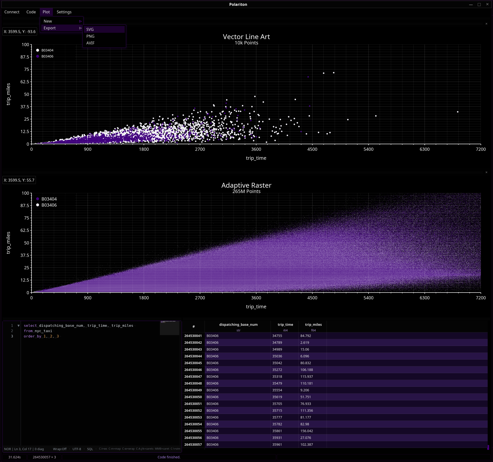

## Polariton

A strong coupling of data and visualization.

#### Installing:

If `cargo deb --install` is configured in your environment, Polariton can be installed directly:

```bash
cargo deb -p polariton --install
```

#### Features:
 - Query 10M rows into local memory in milliseconds.
 - Memory model is polars::frame::DataFrame for blazing fast analytics.
 - Instant scolling, no kill -9 required to scroll though 10M rows.
 - Made with 100% Rust, no JVM garbage factories included. 🦀
 - Batteries included, all drivers are bundled.
 - Generic SQL syntax highlighting.
 - Supports both DDL and DML.
 - Resizable & Rearrangeable ui panels.
 - Rune-only startup configuration.

#### Configuration:

Polariton reads user-authored configuration from `init.rn`. On Linux, the
default path is `~/.config/polariton/init.rn` (or
`$XDG_CONFIG_HOME/polariton/init.rn`). macOS and Windows use their standard
application configuration directories.

```rune
pub fn main(config) {
    config.window_size(
        1920,
        1080,
    )?;
    config.show_column_types(true)?;
}
```

Libaryon's editor settings live in a separate `editor` function in the same
file. Persistent `:set` commands update only this function; Polariton's
application-owned `main` function and all other Rune code are preserved.
`:set init` or `:init` writes a full snapshot of the current editor settings,
while `:init0` restores the editor defaults.

Missing configuration is a clean no-op. A broken script is reported in the
status bar while Polariton still opens with compiled defaults.

#### Rune table presentation:

The application setting applies to every table. A Rune table can opt in
independently in a proven view position:

```rune
workspace.table("events").views([
    table().show_types(),
])
```

`.show_types()` composes in either order with the table's `.skin(...)` and
`.duotone()` members.

#### Adapters:
 - SQLite (file or memory)
 - Parquet (single file)

#### Screenshots:


#### Backlog:
 - Jump to row
 - Shift+Enter to run code
 - Tab/Shift+Tab gui navigation
 - Improved status bar
 - Sort / Filter by column
 - Run selected code, not the entire code editor.
 - Password protection.
 - More data sources (Postgres, MySQL, BigQuery, Redshift, ad inf...)
 - Scatter / Line / Bar plots
 - Hexbin / Kernel Density plots
 - Qwen Coder SQL generator
