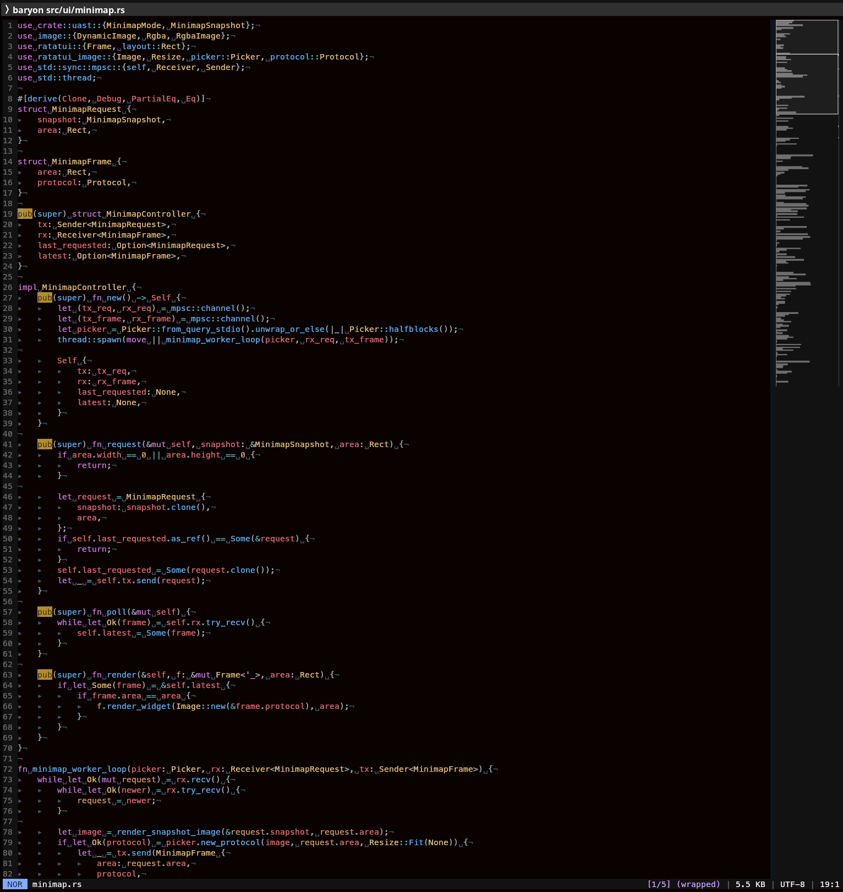

## Baryon

Baryon is a headless editor engine plus a standalone modal terminal editor, built around a sparse
virtual projection pipeline. The current focus is dogfooding: making large-file navigation,
byte-accurate editing, visual feedback, and language-aware highlighting hold up under real daily
use.

It is not a full Vim or NeoVim replacement yet, but it is well past toy status. Baryon now supports real editing sessions with modal input, multiple tabs and split panes, search and substitute, undo/redo, visual selections, multicursor editing, code folding, syntax and semantic highlighting across eleven languages, a live markdown preview, a file browser, and a threaded right-hand minimap.

### Current State

- Terminal frontend built with `ratatui` and `crossterm`; modal input is engine-owned
- Normal, Insert, Command, Search, Confirm, and Visual modes, dispatched from an engine-side data-driven keymap
- Vim-like navigation: `h/j/k/l`, `w/b/e`, `gg`, `G`, `0`, `^`, `$`, `%`, `f/F/t/T` with `;`/`,` repeat, `H/M/L`, `Ctrl-d/u`, `Ctrl-f/b`, `PageUp`/`PageDown`, arrow keys, mouse clicks, and wheel scroll
- Document tabs (`:tab`, `:tabedit`, `gt`/`gT`) and split panes (`:panehsplit`, `:panevsplit`) with keyboard focus and keyboard/mouse resize
- Side-by-side diff of the current file against another with `:panediff`
- Point multicursor editing with `Alt-j` / `Alt-k` for adjacent lines and Alt-click for arbitrary positions
- Code folding with `za`/`zc`/`zo`, `zM`/`zR`, and `]m` to jump to the next function
- Search with `/pattern`, `n`/`N`, `*` for the word under the cursor, and search history recall
- Substitute commands for current line, explicit ranges, visual selections, whole-file replacement, and interactive confirm flows
- `:sort` and `:uniq` over ranges with unique, numeric, and case-insensitive flags
- Visual char, line, and block selection with yank, delete, and change
- Operator motions and text objects including `diw`, `ciw`, `daf`, `caf`, and `D`
- Linewise yank/put with unnamed register, named registers, and system clipboard support
- Syntax highlighting for Rust, Python, Bash, Rune, SQL, TOML, Markdown, HTML, JSON, CSV, and TSV — lexical baseline synchronously, semantic analysis asynchronously (rust-analyzer crates for Rust, ruff for Python, sqlparser for SQL)
- Live rendered markdown preview in a split pane (`:mdpreview`) with inline image rendering and a serif variant
- Read-only file browser (`:tree`) with keyboard navigation and entry search
- Color themes: twenty-plus curated syntax themes (dracula, gruvbox, kanagawa, nord, onedark, solarized, tokyonight, ...) plus continuous colormap themes (viridis, inferno, magma, turbo, ...), with per-language overrides via `:set language.theme` (`langtheme` remains an alias)
- Configurable UI palette roles for accents, surfaces, ordinary text, editor, search, minimap, gutter, status bar, tabs, Markdown preview, and split dividers
- Persistent settings in `settings.toml` through a declarative `:set` registry, with session-only toggles like `:wrap`, `:minimap`, `:num`, `:relnum`, and `:vis`
- First-class Rune startup and live sourcing: `init.rn` can register commands, typed options, and key mappings; `:source PATH` atomically loads or replaces a source generation
- Automatic reload of files changed on disk (`:set reload`)
- Command line with history recall, path/language/theme/setting tab completion, and did-you-mean suggestions for mistyped commands
- Threaded protocol-aware right-hand minimap with viewport and search markers
- Streaming save path with atomic temp-file writes and sparse rebind after save
- 64-bit document coordinates, lazy-paged registry storage, persistent sparse line indexes, and
  bounded resident source data for 80–200 GiB address spaces
- Integrated help: `baryon --help [TOPIC]` and in-editor `:help`, both generated from the command, option, and keybinding registries
- Regression tests around modal key dispatch, tab-aware cursor math, undo/highlight state, sparse mutation, visual range math, folding, minimap search bands, and settings round-trips

### Running

```bash
cargo run -p baryon -- path/to/file.rs
```

If no path is provided, Baryon starts without loading an initial file.

Resident clean source data defaults to 64 MiB per engine session. Set
`BARYON_RESIDENT_MIB` to tune the high-water mark; dirty and currently visible data remains pinned.
The first open of an unchanged large file counts lines in the background, while later opens reuse
an identity-checked line index from the user cache directory.
Features that still require a complete document snapshot are explicitly declined above 256 MiB
instead of allocating by file size; sparse navigation, bounded edits, and streaming save remain
available.

The terminal frontend loads `init.rn` beside `settings.toml` when that file exists. A minimal config
can register callbacks against the guarded live editor handle:

```rune
pub fn main(editor) {
    baryon::command(editor, "hello", |editor, args, bang| { "hello from Rune" });
    baryon::map(editor, "normal", "Q", |editor| { "Q pressed" });
}
```

Use `:source path/to/plugin.rn` to load or atomically replace another source generation, and
`:source! path/to/plugin.rn` to unload it. Library embedders remain opt-in by setting
`EngineConfig::init_script`; `EngineConfig::default()` never executes a user script.

Useful development commands:

```bash
cargo test --workspace
cargo check --workspace --all-targets
```

### Embedding the engine

The `libaryon` crate has no ratatui or crossterm dependency. A frontend starts an engine, sends either
semantic `EditorCommand` values or portable `InputEvent` values, and renders `Viewport` projections:

```rust
use libaryon::engine::{EditorCommand, EngineConfig, EngineHandle};

let mut engine = EngineHandle::spawn(EngineConfig::default());
let commands = engine.command_sender();
let viewports = engine.take_viewports().expect("viewport receiver");

commands
    .send(EditorCommand::Resize(100, 30))
    .expect("engine command channel");
let viewport = viewports.recv().expect("projected viewport");
// Render viewport.panes in a terminal, GUI, or another host.

engine.shutdown().expect("engine thread");
```

Run the terminal-free example against a file with:

```bash
cargo run -p libaryon --example headless -- README.md
```

### Installing

If `cargo deb --install` is configured in your environment, Baryon can be installed directly:

```bash
cargo deb -p baryon --install
```

On systems where you want Baryon available as `vim`, `vi`, or the generic `editor`, register it with `update-alternatives`:

```bash
sudo update-alternatives --install /usr/bin/vim vim /usr/bin/baryon 100
sudo update-alternatives --config vim

sudo update-alternatives --install /usr/bin/vi vi /usr/bin/baryon 100
sudo update-alternatives --config vi

sudo update-alternatives --install /usr/bin/editor editor /usr/bin/baryon 100
sudo update-alternatives --config editor
```

### Editor Commands

Every command, setting, and keybinding is discoverable without leaving the
terminal: `baryon --help` prints the full reference (`--help commands`,
`--help keys`, `--help set`, or any command name), and `:help [topic]` inside
the editor opens the same content rendered in a markdown preview pane.
Mistyped commands suggest the closest match.

A taste of the basics:

Normal mode:

- `i` enters insert mode
- `u` undo
- `Ctrl-r` redo
- `yy` yank current line
- `p` put yanked text below the current line
- `"` selects a register prefix, for example `"ayy`, `"ap`, `"+yy`, `"+p`
- `/` starts search; `*` searches the word under the cursor
- `:` opens the command line
- `v`, `V`, and `Ctrl-v` enter visual char, line, and block mode
- `diw`, `ciw`, `daf`, `caf`, and `D` are implemented
- `za`, `zc`, `zo` toggle/close/open the fold; `zM` and `zR` fold and unfold everything
- `gt` and `gT` switch tabs
- `s` is the pane prefix: `sh/sj/sk/sl` focus a pane, `ss`/`sv` split, `sc` close, `sr` enters resize mode; pane dividers can also be dragged with the mouse
- `Alt-j` and `Alt-k` add cursors below and above; Alt-click adds one at the clicked position
- typing, paste, newline, tab, `x`, `X`, `r`, `~`, backspace, and delete apply at every cursor as one undo step
- `Esc` collapses secondary cursors from Normal mode

Visual mode:

- `y` yank selection
- `d` delete selection
- `c` change selection and enter insert mode
- movement keys extend the active selection

Command mode:

- `:w` write current file
- `:w path` write to a new path
- `:x` or `:wq` write and quit
- `:q`, `:exit`, or `:quit` quit
- `:e path` open another file; bare `:e` reloads from disk (`:e!` discards changes)
- `:tab`, `:tabedit path` (`:te`), `:tabnext` (`:tn`), `:tabprev` (`:tp`), `:tabclose` (`:tc`) manage tabs
- `:panehnew [language]` (`:paneh`, `:ph`, `:new`) and `:panevnew [language]` (`:panev`, `:pv`, `:vnew`) open an independent empty document; `:panehsplit` (`:phs`) and `:panevsplit` (`:pvs`) open another view of the current document; `:paneclose` (`:panec`, `:pc`) closes a pane; `:panediff path` (`:paned`, `:pd`) diffs against another file
- `:tree` opens the file browser
- `:mdpreview` opens a live markdown preview
- `:theme name` switches the color theme; `:language lang` overrides syntax detection
- `:set option [value]` changes a setting and persists it to `settings.toml`
- `:source path/to/plugin.rn` loads or reloads a Rune source; `:source!` unloads it
- `:set colors.accent 8fbcbb` changes the shared UI accent; scoped keys such as `colors.minimap.accent` override one consumer
- `:set colors.surface 202020` and `:set colors.text dadada` recolor unpinned chrome surfaces and text without changing the editor buffer pair
- `:set colors.tab.surface eeeeee` and `:set colors.tab.active.surface 20262e` configure the tab bar's focused/unfocused contrast pair
- `:set colors.search.highlight ffd700` customizes search matches and minimap hit markers (`searchhighlight` remains an alias)
- `:set colors.minimap.accent default` clears a scoped override; `:set colors.minimap.accent?` reports its resolved value and provenance
- `:42` jump to line 42
- `:s/foo/bar/` substitute on the current line
- `:%s/foo/bar/g` substitute across the whole file
- `:1,20s/foo/bar/c` ranged substitute with confirmation
- `:sort u` sort the file, dropping duplicates; `:uniq` removes adjacent duplicates

Syntax themes and UI colors are intentionally independent. A syntax theme belongs to a document's
UAST and can vary by pane or language; the UI palette belongs to the editor session. Use
`:set language.theme LANG THEME` (or the `langtheme` alias) for syntax and `:set colors.*` for
chrome. Use `tree` (or its `files` alias) as the language-theme target to give the file tree its
own persistent syntax colors. The legacy `background` and `searchhighlight` setting names remain
accepted as aliases for `colors.editor.background` and `colors.search.highlight`. On the next
settings save, legacy
`[ui]` color keys are rewritten into canonical nested `[ui.colors...]` sections; older Baryon
versions will not understand those sections.

### Architecture

The project is a two-crate workspace organized as a layered editor pipeline rather than a
monolithic text buffer:

- `crates/libaryon/`: headless library containing shared primitives, ECS storage, sparse projection,
  language providers, modal input and command registries, the command loop, settings/themes, and the
  public engine host API
- `crates/baryon/`: ratatui/crossterm frontend containing terminal input translation and rendering,
  mouse hit-testing, CLI startup, and terminal lifecycle

The engine runs on its own thread. Frontends communicate through typed `CommandSender` and
`InputSender` adapters plus a `Receiver<Viewport>` obtained from `EngineHandle`; both senders share one
ordered request stream. The viewport uses tokens, spans, typed geometry, input projection, and RGB
values rather than terminal cells.

Languages plug in through a `LanguageProvider` trait: a provider declares its extensions, a synchronous lexical baseline for the viewport, and an asynchronous semantic reactor over the full document. Adding a language means registering one provider — no core engine changes. Similarly, ex-commands, settings, and keybindings live in declarative registry tables that drive dispatch, tab completion, and every help surface from a single source of truth.

### Limitations

- Semantic depth varies by language: Rust (rust-analyzer) and Python (ruff) go deepest; the rest are lighter-weight lexical and structural passes
- The editing model is still intentionally narrower than Vim or NeoVim: no macros, and the operator/text-object grammar covers common cases rather than the full combinatorial space
- Some everyday editing edges are still rough during dogfooding, especially outside the currently-covered modal/navigation/search flows
- The codebase is still evolving quickly, especially around typed coordinate boundaries and render/highlight plumbing

### Platform Notes

Baryon currently targets a Linux-style terminal workflow and includes `io_uring` in its storage/ingestion layer. It is being developed primarily as a systems-oriented editor experiment, so the implementation is optimized for clarity of internal boundaries more than broad platform polish at this stage.

### Screenshots

