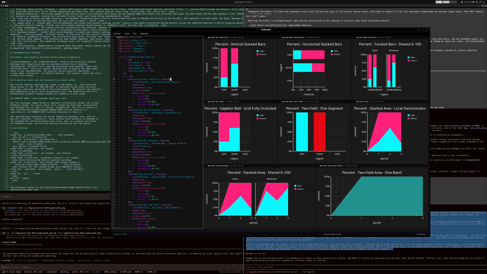

# PRODUCT-0075 implementation evidence: retiring the nested dashboard

Implemented 2026-08-10 against
`plans/product/adr/0075_retiring_the_nested_dashboard.md`.

## Outcome

Polariton now has one pane owner. Plain Rune's sole optional plot is projected
as `(DocumentId, Anonymous(0))` through the same durable host-panel map used by
relation `.views`; Markdown `output = pane` replaces the shared Results panel;
and Plot -> Export snapshots the plot content actually visible in libaryon's
host-panel viewport. The nested dashboard, its independent pane grid, its
settings editor, its `DataFrame` cache, and the Plot -> New picker are gone.

Saved layouts written before this change may still contain fixed panel ID 2.
After PRODUCT-0062 meaning reconciliation reaches either success or terminal
refusal, Polariton sends one ordinary close intent for each projected
occurrence. No application-owner bytes are interpreted or rewritten by the
tombstone.

`PlotType::ALL` remains deliberately. It is now documented and guarded as the
exact renderer catalog, not as picker data. Kernels without Rune spellings
remain direct-test substrate.

## Acceptance gates

| gate | evidence | result |
|---|---|---|
| 1. Plain identity and cardinality | `product_0075_plain_plot_owns_anonymous_zero_and_orphans_when_removed` drives the real update handler, observes exactly one kernel task, one running `Anonymous(0)` mapping, an expansive plot presentation, and no panel 2. Existing plain-host tests retain zero/one/refuse cardinality | pass |
| 2. Schema remains v2 | `product_0075_plain_anonymous_zero_is_existing_schema_two_vocabulary` encodes panel/group meaning, pins `kind=anonymous` and `ordinal=0`, refuses new `plain`/`dashboard` vocabulary, and round-trips under schema 2 | pass |
| 3. Restart and repopulation | The saved-process gate `product_0070_saved_restart_preserves_product_0062_views_groups_and_colours_before_rerun` now includes `Anonymous(0)`: a scratch document checkpoints, reopens unresolved under the exact `HostPanelId`, and a rerun installs a plot into that same panel | pass |
| 4. Empty rerun and identity collision | The plain integration gate reconciles a later no-plot run to `orphaned`, then presents an anonymous relation sink and a named control. Anonymous zero reuses the panel; the named sink mints separately | pass |
| 5. Markdown Results routing | `product_0075_markdown_pane_plot_uses_results_while_inline_and_none_do_not` proves pane output becomes a visible Results plot and exports. `product_0075_results_replace_table_plot_and_message_under_one_panel` pins table -> plot -> message -> table under panel 1 with increasing revisions. Inline retains native plot content; None retains none; neither creates Results | pass |
| 6. Menu surface | `product_0075_plot_menu_retains_only_the_three_export_actions` recursively inspects the consumed menu model and pins exactly SVG, PNG, and AVIF. The architecture gate forbids every `plot:new:` production action | pass |
| 7. Visible-content selection | `product_0075_export_reads_visible_plot_geometry_and_keeps_stale_last_good` includes a stale last-good plot and excludes the same visible panel after its content becomes a message. Selection intersects viewport identity with `PanelContent::Plot`, never producer state | pass |
| 8. Ordering, deduplication, filenames | `product_0075_export_order_deduplicates_identity_not_titles` feeds duplicate panel identity, duplicate titles, `/`, and non-ASCII through the selector. First viewport occurrence wins once; titles neither deduplicate nor name files. The rendered jobs pin `plot_1.svg`, `plot_2.png`, and `plot_3.avif` | pass |
| 9. Rendered dimensions | The visible geometry gate derives width from projected cells minus two 4px padding edges and height from projected rows minus the 22px header and the same padding. A zero `PaneRect` produces no snapshot, closing the fractional-to-zero raster cast found during implementation | pass |
| 10. Three real artifacts and empty behavior | The Markdown integration gate writes all three production jobs at 160x100 and verifies an SVG document, PNG signature, and AVIF brand. The empty `Message::Export` branch emits no task and the exact `No live plots to export.` status | pass |
| 11. Legacy panel 2 | `product_0075_retired_dashboard_role_closes_once_without_touching_results` injects a real panel-2 projection beside Results, proves the tombstone observed it before accepting absence, and proves Results remains. Cleanup runs after pending meaning reconciliation in `CodeEditor::poll` and uses only `CloseDocTab` | pass |
| 12. Owner independence | The cleanup function consumes only the projected `(PaneId, ViewId)` occurrences and never application meanings. `None`, successful, and terminally failed meaning reconciliation all precede it in one ordered poll block; the terminal-refusal control proves cleanup neither interprets nor replaces that error, and a projection without panel 2 emits nothing | pass |
| 13. Dashboard absence | `product_0075_nested_dashboard_is_absent_and_renderer_catalog_is_exact` proves both source directories are absent and production contains no dashboard state/message/effect, `PlotPaneState`, `rune_plot_panes`, or picker action. It also pins the sole value-2 reference as the named tombstone | pass |
| 14. Renderer vocabulary retained | The architecture gate parses `PlotType` and `PlotType::ALL`, proves exact set equality and no duplicates, while the full kernel/factory suite remains green | pass |
| 15. Derived cache removed | The architecture gate bounds `AppState` and rejects `data_frame`; established SQL, Markdown, result-registry, and UAST tests pass without changed expectations | pass |
| 16. Full verification | The sequential workspace suite, all-target/all-feature checks, saved-session process gates, trybuild suites, and PRODUCT-0057 Vulkan renderer pass. No ignored test was newly admitted | pass |
| 17. Live acceptance | PRODUCT-0074's accepted dense host-panel exhibit remains the replacement oracle. A post-removal production window renders all eight `test24.rn` plots in host panels with no dashboard role or Plot -> New surface. Plot -> Export -> AVIF reports `Exported 8 plots as AVIF.` and writes eight non-empty artifacts | pass |

## Live exhibit



The capture is the production `cargo run -p polariton -- ../uat/test24.rn`
window after executing the buffer. Its status bar records the completed live
AVIF export; the eight generated files are deliberately not checked in.

## Implementation findings

### Generic view identity had been feature-gated accidentally

`LocalViewIdentity` and `ViewPresentation` lived in the Toron-only relation
envelope even though plain Rune is available without Toron. Reusing
`Anonymous(0)` therefore first required extracting those adjacent types into
the always-built `rune_view` module. Relation Rune re-exports the same types;
there is one representation, not parallel feature-specific identities.
`cargo check -p polariton --no-default-features --all-targets` proves the plain
surface still builds.

### A positive extent was not necessarily a raster extent

The initial selector admitted any `width > 0 && height > 0`, then converted
those values to `u32` for PNG and AVIF. A fractional extent below one pixel
would pass selection and become a zero-sized backend. The selector now requires
both dimensions to be at least one physical pixel. The undersized control is
deliberately synthetic because normal cell geometry is much larger.

### PRODUCT-0059's later-consumer guard was stale

The full workspace sweep failed in libaryon's architecture target, not in the
dashboard change. Its source guard still claimed any Polariton `SessionStore`
use belonged only in `main.rs` and any `SavedSession` use only in `editor.rs`.
That contradicted already-shipped PRODUCT-0063 startup authority in
`gui/state.rs` and PRODUCT-0073 terminal discovery in `main.rs`.

The repaired guard preserves the actual capability boundary: only `main.rs`
may call read-only `.discover()`, while session-store authority is bounded to
the accepted GUI controller/editor host files. This is a premise correction,
not dashboard scope, and the once-failing architecture test now passes.

## Verification

```text
cargo test -p polariton product_0075 -- --test-threads=1
  pass (8 unit + 1 architecture)
cargo test -p polariton --bin polariton \
  editor::tests::product_0070_saved_restart_preserves_product_0062_views_groups_and_colours_before_rerun \
  -- --exact --test-threads=1
  pass (parent + isolated child)
cargo check -p polariton --all-targets
  pass, no warnings
cargo check -p polariton --all-targets --all-features
  pass, no warnings
cargo check -p polariton --no-default-features --all-targets
  pass (three pre-existing feature-substrate warnings)
cargo test -p polariton --test product_0057_render_evidence \
  --features product-0057-render-evidence -- --test-threads=1
  pass (Vulkan; all four backend probes plus 0068/0072 strata)
cargo test --workspace --all-targets --quiet -- --test-threads=1
  pass
cargo fmt --all -- --check
  pass
git diff --check
  pass
```

The workspace retains its pre-existing environment-gated ignored tests; this
implementation adds none.
